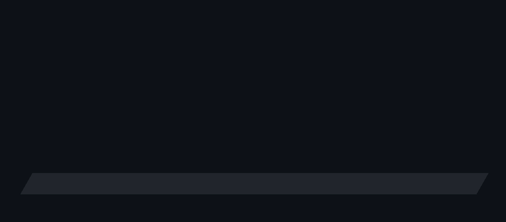
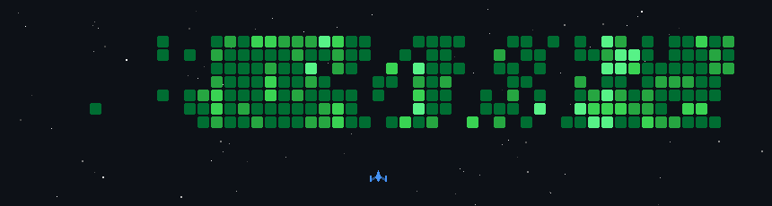

<h1>Jainil Patel</h1>

  <picture>
    <source media="(prefers-color-scheme: dark)" srcset="./assets/commits-dark.gif">
    <source media="(prefers-color-scheme: light)" srcset="./assets/commits.gif">
    
  </picture>

---

## 💫 About Me

<table>
  <tr>
    <td width="30%">🎓 <b>Education</b></td>
    <td>4th-year B.Tech. Computer Science & Engineering student</td>
  </tr>
  <tr>
    <td>🔭 <b>Working on</b></td>
    <td><b>UI HUB</b>: a prompt platform for vibe coders to build UI components with AI tools <b>CodeBazaar</b>: a marketplace to buy source code and download it as ZIP files</td>
  </tr>
  <tr>
    <td>🌱 <b>Learning</b></td>
    <td><b>Data Structures & Algorithms with Python</b> and the <b>NPTEL Internet of Things (IoT)</b> course</td>
  </tr>
  <tr>
    <td>⚙️ <b>What I build</b></td>
    <td>Full-stack web apps with React, TypeScript, Node.js/Express and Firebase, plus ML model deployment</td>
  </tr>
  <tr>
    <td>🤝 <b>Open to collaborate on</b></td>
    <td>Web apps, Python projects and beginner-friendly open source</td>
  </tr>
  <tr>
    <td>📫 <b>Reach me</b></td>
    <td><a href="mailto:jainil11199@gmail.com">jainil11199@gmail.com</a></td>
  </tr>
</table>

---

## 🌐 Socials

  
  
  
  

---

## 🚀 Projects

<table>
  <tr>
    <td width="33%" valign="top">
      <h3>🧩 UI HUB</h3>
      A platform for vibe coders: copy ready-made prompts, paste them into your AI tool, and build UI components in seconds.  
      
    </td>
    <td width="33%" valign="top">
      <h3>🎨 Chromatic</h3>
      A colour-focused web tool built with TypeScript.  
      
    </td>
    <td width="33%" valign="top">
      <h3>🌍 Portfolio</h3>
      My personal website showcasing my work and skills.  
      
    </td>
  </tr>
</table>

---

## 💻 Tech Stack

  
  
  
  
  
  
  
  
  
  
  
  
  

---

## 🧠 Coding Profiles

  

---

  

